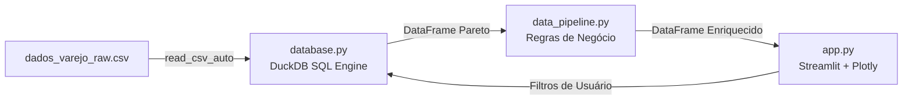

# 📊 Retail Turnaround Analytics & Working Capital Optimization

[](https://www.python.org/)
[](https://duckdb.org/)
[](https://streamlit.io/)
[](https://plotly.com/)
[](#-arquitetura-do-projeto)

> Estudo de caso analítico e cockpit executivo voltado para **Turnaround Operacional e Governança de Capital de Giro** no grande varejo de bens duráveis. A solução combina processamento analítico de alta performance via SQL colunar in-process (**DuckDB**) com modelagem de regras de negócio em **Python** e interface executiva interativa em **Streamlit**.

---

## 📌 Contexto de Negócio & O Problema

No grande varejo tradicional, empresas com faturamento anual bilionário frequentemente enfrentam severas crises de liquidez e insolvência. Esse paradoxo decorre de duas armadilhas estruturais de capital de giro:

1. **O Efeito Tesoura (Descasamento Temporal de Caixa):**
   * Prazos médios com indústrias e fornecedores (**PMP**) curtos ($\approx 64$ a $75$ dias).
   * Modelo legado de parcelamento em carnê/crediário próprio com Prazos Médios de Recebimento (**PMR**) extensos ($\approx 450$ a $540$ dias ponderados).
   * **Consequência:** Um hiato financeiro de centenas de dias descobertos que força captação de dívida a juros elevados para sustentar o caixa e absorção direta de Provisão para Devedores Duvidosos (**PDD**) no balanço da varejista.

2. **Distorção de Sortimento e Estoque Imobilizado (Curva ABC Desalinhada):**
   * Curva ABC historicamente montada sob faturamento bruto, camuflando itens com margem ínfima ou negativa.
   * Estoque próprio (1P) alocado massivamente na **cauda longa (Classe C)**, gerando prazos médios de estoque (**PME**) superiores a 180 dias, custos de armazenagem e queima forçada de preços por obsolescência.

---

## 💡 A Solução Proposta

Este projeto implementa um modelo analítico e uma ferramenta de tomada de decisão com foco em duas alavancas de turnaround:

* **Governança da Curva ABC por Lucro Real:** Reclassificação de todo o portfólio via cálculo analítico de Margem de Contribuição e Pareto. Aplicação de trava sistêmica imediata para compras de estoque próprio (1P) em itens da Classe C, com recomendação de migração para o canal de *Marketplace* (3P, Take Rate limpo sem imobilização).
* **Simulação de Desintermediação de Crédito:** Modelagem da transição do carnê próprio para modelo bancário parceiro (*White Label* em D+30). O caixa passa a entrar em 30 dias — **34 dias antes do vencimento com o fornecedor** —, transformando a necessidade de capital de giro em autofinanciamento e transferindo 100% da inadimplência para o parceiro bancário.

---

## 🏗️ Arquitetura do Projeto

Em aderência aos princípios de Engenharia de Software e *Separation of Concerns* (SoC / Single Responsibility Principle), o projeto recusa o padrão de script monolítico único e divide-se estritamente em **3 camadas desacopladas**:

```
projeto_casas_bahia/
│
├── dados_varejo_raw.csv    # Base de dados bruta (Vendas, Estoques, PMP, Preços e Custos)
│
├── database.py             # CAMADA 1: Motor Analítico SQL In-Process (DuckDB)
│                           # - Ingestão colunar ultrarrápida
│                           # - Window Functions (SUM OVER) para Pareto
│                           # - Consultas analíticas parametrizadas
│
├── data_pipeline.py        # CAMADA 2: Domínio & Regras de Negócio (Python puro)
│                           # - Diretrizes operacionais por SKU (1P vs. 3P)
│                           # - Motor de simulação de liquidez e descasamento temporal
│
├── app.py                  # CAMADA 3: Camada de Apresentação (Streamlit & Plotly)
│                           # - Cockpit executivo interativo
│                           # - Gráficos de Pareto (duplo eixo Y) e Matriz de Giro vs. Margem
│                           # - Cards de métricas financeiras (Fintech Design System)
│
└── README.md               # Documentação técnica e de negócio do projeto
```

### Detalhamento das Camadas



* **`database.py` (Data Access & Analytical Engine):** Utiliza o **DuckDB** para executar transformações pesadas direto no arquivo via SQL analítico. Aplica *Common Table Expressions* (CTEs), funções de janela (`SUM(...) OVER (ORDER BY ... ROWS BETWEEN UNBOUNDED PRECEDING AND CURRENT ROW)`) para o cálculo acumulado de Pareto e sanitização com `NULLIF` e `COALESCE`.
* **`data_pipeline.py` (Business Logic & Domain Layer):** Camada pura em Python que encapsula a lógica de decisão (ex.: avaliação de dias de cobertura `PME <= 35` vs. bloqueio de compra 1P) e parametrizações de cenários de crédito.
* **`app.py` (Presentation Layer):** Interface web responsiva estilizada sob paleta executiva corporativa (*Executive Slate & Emerald*). Consome apenas as funções dos módulos anteriores, gerenciando o ciclo reativo e cacheamento (`@st.cache_data`).

---

## 📈 Principais Métricas & Resultados do Modelo

A execução sobre a base analítica consolidou:

| Métrica | Cenário Base / Apurado | Impacto no Turnaround |
| :--- | :---: | :--- |
| **Faturamento Total** | R$ 44.810.450,00 | Volume bruto transacionado no portfólio |
| **Margem Bruta (Lucro Real)** | R$ 12.157.475,00 (27,1%) | Rentabilidade real gerada pela operação |
| **Estoque Total Imobilizado** | R$ 2.602.850,00 | Capital circulante alocado nos centros de distribuição |
| **Estoque Retido em Linha C** | R$ 255.050,00 | **Alvo imediato de bloqueio de compras 1P** e queima |
| **PMR Crediário Próprio** | $\approx 450$ dias | Gap de caixa severamente deficitário |
| **PMR Parceria Bancária (D+30)** | 30 dias | **Gap invertido para -34 dias** (caixa positivo e 0% PDD) |

---

## 🚀 Como Executar o Projeto

### Pré-requisitos
* Python 3.10 ou superior instalado.
* Git instalado (opcional, para clonagem).

### 1. Clonar o Repositório
```bash
git clone https://github.com/SEU_USUARIO/SEU_REPOSITORIO.git
cd SEU_REPOSITORIO
```

### 2. Criar e Ativar Ambiente Virtual (Recomendado)
* **Windows (PowerShell):**
  ```powershell
  python -m venv venv
  .\venv\Scripts\Activate.ps1
  ```
* **Linux / macOS:**
  ```bash
  python3 -m venv venv
  source venv/bin/activate
  ```

### 3. Instalar as Dependências
```bash
pip install streamlit duckdb pandas plotly
```

### 4. Executar a Aplicação
Certifique-se de que o arquivo `dados_varejo_raw.csv` está na raiz do diretório e execute:
```bash
streamlit run app.py
```

O dashboard será inicializado automaticamente no navegador no endereço `http://localhost:8501`.

---

## 🛠️ Tecnologias Utilizadas

* **[DuckDB](https://duckdb.org/):** Processamento analítico colunar (OLAP) in-process com pushdown de queries SQL sobre arquivos delimitados.
* **[Python](https://www.python.org/):** Linguagem principal para regras procedurais de negócio e orquestração.
* **[Pandas](https://pandas.pydata.org/):** Estrutura tabular para transporte de dados intermódulos.
* **[Streamlit](https://streamlit.io/):** Framework para cockpit web executivo e reativo.
* **[Plotly](https://plotly.com/python/):** Visualizações interativas customizadas (Curva de Pareto com eixo duplo, matriz de giro vs. margem e dispersão).

---

## 👤 Autoria & Contato

Desenvolvido por **Maria** — Pós-graduada em Engenharia de Dados & Especialista em Soluções Analíticas.

* **LinkedIn:** (www.linkedin.com/in/maria-eduarda-nascimento-980579372)
* **GitHub:** ([https://github.com](https://github.com/mariaeduarda-dataeng))

---
*Projeto desenvolvido para fins de demonstração técnica e resolução de casos estratégicos de negócios.*
